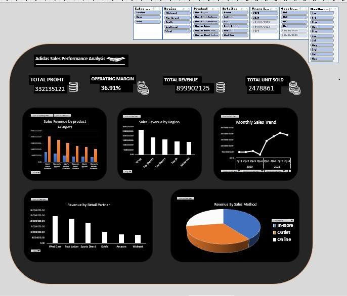
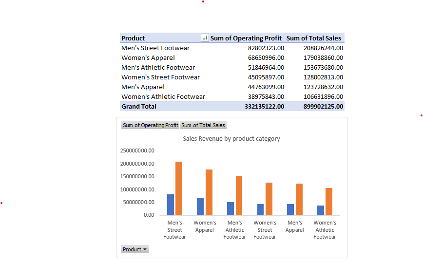
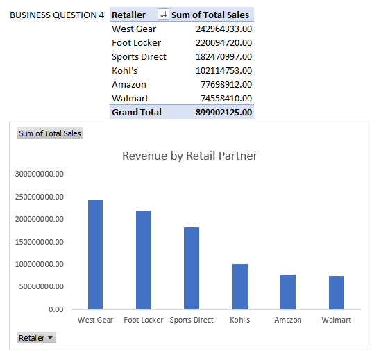
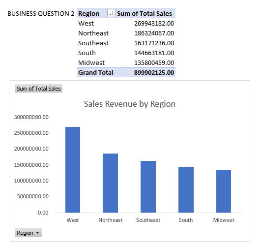
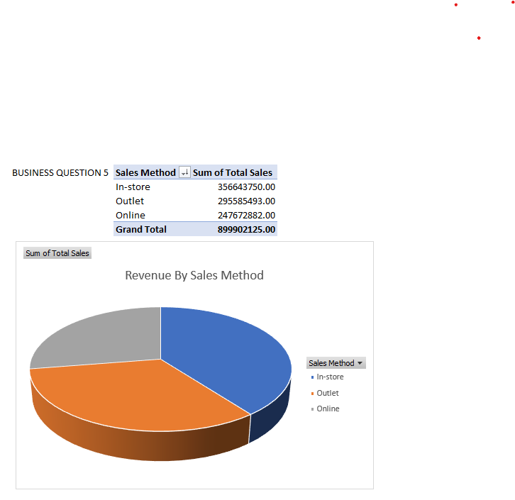
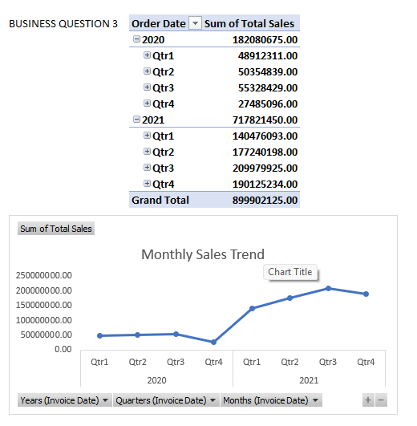

# Adidas Sales Performance Analysis and Interactive Excel Dashboard (2020–2021)

**An Individual Data Analytics Capstone Project | Digital Empowered Academy (DEA)**

**Author:** Muhammed Sediq Sule  
**Tools:** Microsoft Excel  
**Project Period:** January 2020 – December 2021  
**Submission Date:** 26 December 2025

---

## 1. Project Overview

This project explores Adidas retail sales performance across the United States between January 2020 and December 2021. Using Microsoft Excel, I analysed 9,648 sales records to identify patterns in revenue generation, operating profitability, product performance, regional distribution, retailer contributions and sales channels.

The primary objective was to transform raw sales data into meaningful business insights that could support strategic decision-making, improve sales performance and identify opportunities for business growth.

The analysis was presented through an interactive Excel dashboard supported by PivotTables, PivotCharts and Slicers.

### Project Objectives

1. Evaluate overall sales performance and profitability.
2. Identify the highest- and lowest-performing product categories.
3. Examine sales performance across geographical regions.
4. Compare the contributions of different retail partners.
5. Evaluate the performance of in-store, outlet and online sales channels.
6. Examine sales trends across yearly, quarterly and monthly periods.
7. Develop data-driven recommendations to improve business performance.

---

## 2. Dataset Description

The analysis used an Adidas sales dataset containing transaction-level information covering January 2020 to December 2021.

| Dataset Attribute | Description |
|---|---|
| Total Records | 9,648 |
| Total Columns | 13 |
| Retailers | 6 |
| Regions | 5 |
| States | 50 |
| Product Categories | 6 |
| Sales Methods | 3 |
| Period Covered | January 2020 – December 2021 |

### Dataset Variables

The dataset contains the following fields:

- Retailer
- Retailer ID
- Invoice Date
- Region
- State
- City
- Product
- Price per Unit
- Units Sold
- Total Sales
- Operating Profit
- Operating Margin
- Sales Method

**Dataset Source:** [Adidas Sales Dataset – Google Sheets](https://docs.google.com/spreadsheets/d/1g7KJp8zNcRXuYfrV1ScNAbkM7n6fX0hR/edit)

---

## 3. Tools and Technologies

The primary analytical tool used for this project was Microsoft Excel.

Key Excel features applied included:

- **PivotTables:** Summarising and analysing sales data across different business dimensions.
- **PivotCharts:** Presenting analytical findings through visual representations.
- **Slicers:** Enabling interactive filtering of dashboard information.
- **Excel Dashboard:** Consolidating important performance indicators and visualisations into a single interface.

---

## 4. Data Analysis Methodology

The project followed a structured analytical process:

**1. Data Inspection and Preparation**

Reviewed the dataset to understand its structure, variables, completeness and consistency.

**2. Data Quality Assessment**

Examined missing values, duplicate records and inconsistencies in selected numerical fields.

**3. Exploratory Data Analysis**

Explored the dataset to identify sales patterns and performance differences across products, retailers, regions, sales methods and time periods.

**4. Data Aggregation**

Created PivotTables to summarise total sales, operating profit and units sold across relevant business categories.

**5. Data Visualisation**

Developed PivotCharts to communicate important findings clearly.

**6. Dashboard Development**

Designed an interactive Excel dashboard incorporating key performance indicators, charts and slicers.

**7. Interpretation and Recommendations**

Interpreted the results and developed recommendations based on the observed business performance.

**8. Independent Audit**

Independently recalculated key performance indicators and analytical totals to verify the reported figures against the original dataset.

---

## 5. Key Performance Indicators (KPIs)

The analysis produced the following overall performance indicators:

| Performance Indicator | Result |
|---|---:|
| Total Sales Revenue | **$899,902,125** |
| Total Operating Profit | **$332,135,122** |
| Total Units Sold | **2,478,861** |
| Weighted Operating Margin | **36.91%** |
| Total Transactions | **9,648** |

**Note:** The dataset does not explicitly specify its currency. The dollar symbol is used in this analysis because the dataset covers United States retailers and locations; USD is therefore an assumption rather than a confirmed dataset attribute.

The operating margin of 36.91% represents the weighted margin, calculated by dividing total operating profit by total sales revenue. This provides a more appropriate overall profitability measure than the simple average of individual transaction margins.

---

## 6. Key Findings and Business Insights

### 6.1 Product Performance

Men's Street Footwear emerged as the highest-performing product category, generating approximately $208.8 million in sales and accounting for 23.2% of total revenue.

Women's Apparel followed with approximately $179.0 million, while Men's Athletic Footwear generated approximately $153.7 million.

Key observations:

- Men's Street Footwear recorded the highest sales and operating profit.
- Women's Apparel was the second-highest revenue-generating category.
- Men's Athletic Footwear recorded the lowest operating margin among the six categories at 33.7%.
- Women's Athletic Footwear was the lowest-performing category by sales across all five regions.

### 6.2 Regional Performance

The West region generated the highest revenue, contributing approximately $269.9 million, representing 30.0% of total sales.

However, it also recorded the lowest operating margin at 33.2%.

The South region recorded the highest operating margin at 42.3%, despite generating lower revenue than the West and Northeast.

Key observations:

- The West was the largest revenue-generating region.
- The South demonstrated the strongest profitability.
- New York, California and Florida were among the leading states by sales.
- Men's Street Footwear was the leading product in four of the five regions.

### 6.3 Sales Trend Analysis

The dataset recorded substantial differences in sales volume between the two years.

| Year | Total Sales | Share of Total Sales |
|---|---:|---:|
| 2020 | $182.1M | 20.2% |
| 2021 | $717.8M | 79.8% |

Within 2021, the third quarter recorded the highest sales, reaching approximately $210.0 million.

Other observations:

- Sales increased from the first quarter to the third quarter of 2021.
- The third quarter represented the strongest quarterly performance.
- Sales declined slightly in the fourth quarter.
- July and August were the strongest months across the combined period.

The differences in yearly dataset coverage mean that the increase should not be interpreted as purely organic business growth.

### 6.4 Retailer Performance

West Gear was the largest retail contributor, generating approximately $243.0 million in sales, followed by Foot Locker and Sports Direct.

Together, these three retailers contributed approximately 72% of total sales.

Key observations:

- West Gear generated the highest revenue.
- Foot Locker was the second-largest revenue contributor.
- Sports Direct recorded the highest retailer operating margin at 40.7%.
- Walmart recorded the lowest sales contribution and lowest operating margin among the six retailers.

### 6.5 Sales Channel Performance

The analysis examined three sales methods: In-store, Outlet and Online.

| Sales Method | Total Sales | Revenue Share | Units Sold | Operating Margin |
|---|---:|---:|---:|---:|
| In-store | $356.6M | 39.6% | 689,990 | 35.8% |
| Outlet | $295.6M | 32.8% | 849,778 | 36.5% |
| Online | $247.7M | 27.5% | 939,093 | 39.0% |

Key observations:

- In-store generated the highest revenue.
- Online recorded the highest number of units sold.
- Online also recorded the highest operating margin at 39.0%.
- Outlet contributed substantial sales volume but had a lower margin than online.

These findings highlight the importance of evaluating sales channels using both revenue and profitability indicators.

---

## 7. Business Recommendations

Based on the analytical findings, the following recommendations were developed.

### Product Strategy

- Maintain investment in Men's Street Footwear because of its strong revenue contribution and profitability.
- Continue supporting Women's Apparel as a major revenue-generating category.
- Review the pricing and promotional strategies associated with Men's Athletic Footwear.
- Develop targeted marketing campaigns to improve the performance of Women's Athletic Footwear.

### Sales Channel Optimisation

- Strengthen online sales through product bundles, higher-value promotions and targeted digital campaigns.
- Maintain in-store operations while reducing excessive dependence on individual retail partners.
- Review outlet pricing and promotional strategies to improve profitability.

### Regional Strategy

- Protect the West region's strong revenue contribution while identifying opportunities to improve its operating margin.
- Explore opportunities to expand sales in the South because of its relatively high profitability.
- Evaluate growth opportunities in the Midwest while maintaining operational efficiency.

### Retailer Management

- Strengthen strategic relationships with West Gear, Foot Locker and Sports Direct.
- Investigate the factors contributing to Sports Direct's relatively high operating margin.
- Review Walmart's sales contribution and outlet-heavy sales distribution.
- Introduce measurable sales targets for individual retailers and geographical regions.

### Demand and Inventory Planning

- Consider the observed seasonal sales patterns when planning inventory.
- Prepare inventory and marketing activities ahead of the July–August sales peak.
- Obtain more consistent historical sales information before relying on the dataset for long-term forecasting.

---

## 8. Data Quality Assessment and Limitations

The independent audit identified several data-quality issues that are important when interpreting the findings.

**1. Uneven Yearly Data Coverage**

The dataset contains 1,302 records for 2020 and 8,346 records for 2021. This represents approximately 541% more records in 2021.

Consequently, the difference in annual sales should not be interpreted as purely organic business growth.

**2. Inconsistency Between Price, Units and Total Sales**

In 3,886 of the 9,648 records, multiplying Price per Unit by Units Sold did not produce the recorded Total Sales value.

The analysis therefore used Total Sales as recorded in the original dataset. Unit-based comparisons should be interpreted with caution.

**3. Operating Profit Consistency**

Operating Profit was internally consistent with Total Sales multiplied by Operating Margin across all records.

**4. No Missing Values or Duplicate Records**

The audit identified no duplicate records or missing values in the core analytical fields.

**5. Absence of Sales Targets**

The dataset did not contain sales targets, projections or external benchmarks. Therefore, performance against predefined targets could not be evaluated.

These limitations do not invalidate the analysis, but they provide important context for interpreting the results and making business recommendations.

---

## 9. Project Deliverables

The following materials document the analytical process and findings:

| Deliverable | File |
|---|---|
| Original Dataset | [01_Original_Adidas_Dataset.xlsx.xlsx](original-dataset/01_Original_Adidas_Dataset.xlsx.xlsx) |
| Excel Analysis and Interactive Dashboard | [02_Adidas_Sales_Analysis_Workbook.xlsx.xlsx](analysis/02_Adidas_Sales_Analysis_Workbook.xlsx.xlsx) |
| Project Presentation | [03_Adidas_Sales_Analysis_Presentation.pptx.pptx](presentation/03_Adidas_Sales_Analysis_Presentation.pptx.pptx) |
| Recommendations Report | [04_Adidas_Sales_Recommendations_Report.docx.docx](report/04_Adidas_Sales_Recommendations_Report.docx.docx) |

---

## 10. Dashboard and Analysis Screenshots

The following screenshots provide a visual overview of the Excel dashboard and major analytical outputs.

### Interactive Excel Dashboard

### Product Performance Analysis

### Retailer Performance Analysis

### Regional Performance Analysis

### Sales Channel Analysis

### Monthly Sales Trend

---

## 11. Conclusion

This project demonstrates the application of Microsoft Excel in transforming raw retail sales data into meaningful business insights.

Through data inspection, exploratory analysis, PivotTables, PivotCharts and interactive dashboard development, the project examined Adidas sales performance across multiple business dimensions.

The findings highlighted important differences in product profitability, regional performance, retailer contributions and sales channel effectiveness.

Beyond the development of visual reports, the project also involved independent verification of analytical results, identification of data-quality limitations and the development of practical business recommendations.

---

## 12. About the Author

**Muhammed Sediq Sule**  
Data Analyst | Excel | SQL | Power BI

- **GitHub:** [SEDIBRIGHT-ANALYTICS](https://github.com/SEDIBRIGHT-ANALYTICS)
- **LinkedIn:** [Muhammed Sediq Sule](https://www.linkedin.com/in/sediq-muhammed-404b743a1/)
- **Location:** Zaria, Kaduna State, Nigeria

---

## Acknowledgements

This project was completed as part of the Data Analytics Beginners Capstone Project organised by Digital Empowered Academy (DEA).

Special appreciation to the academy for providing the learning opportunity and practical project experience.